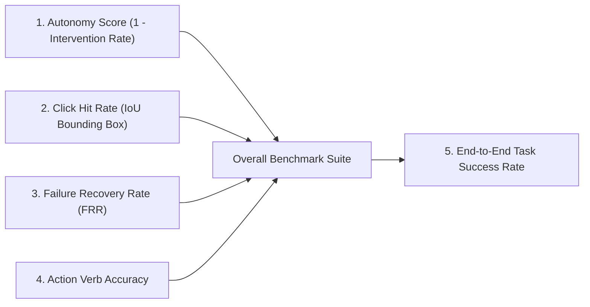

# 🧠 HealVLM: Research & Implementation Master Plan
### *Self-Healing Vision-Language Navigation via Active Failure-Recovery Distillation*

---

## 📌 Executive Summary
Current frontier GUI agents (Anthropic Computer Use, OpenAI Operator) rely on massive cloud models that are **expensive ($0.10–$0.30 per task), slow (2,000–5,000ms latency per step), and transmit private screen pixels to third-party servers**, violating enterprise privacy and HIPAA/GDPR standards. Conversely, small offline models (0.2B–3B) fail in production because they suffer from **compounding error drift**—having only been trained on "happy path" expert demonstrations with no knowledge of how to recover from misclicks, popups, or network lag.

**HealVLM** introduces a **Dual-Brain Active Learning Framework**:
1. An on-device **Student Model (Qwen2-VL-2B in 4-bit)** executes actions at sub-second speeds with $0 cloud cost and 100% data privacy.
2. An integrated **Visual Watchdog (`network_guard.py`)** monitors real-time frame variance to immediately catch stalls or missed clicks.
3. If an error or stall occurs, a **Cloud Teacher Model (Gemini 3.6 Flash via Vertex AI)** is triggered on-demand to perform an active rescue.
4. The exact **Failure State $\rightarrow$ Teacher Rescue Action** pair is harvested into the dataset, continuously training the student to become self-healing and autonomous.

---

## 🔬 Scientific Methodology & Theoretical Formulation

### 1. The "Happy Path" Trap (Compounding Error Distribution Shift)
In standard Behavioral Cloning (BC), an agent learns a policy $\pi_\theta(a_t | s_t)$ exclusively from expert demonstrations:
$$s_t \sim P_{\text{expert}}$$
In real web and desktop environments, minor deviations (a 10-pixel click offset, a delayed spinner, or an unpredicted cookie consent banner) push the state distribution into:
$$s_t \sim P_{\text{unseen}} \quad \text{where} \quad P_{\text{unseen}} \cap P_{\text{expert}} \approx \emptyset$$
Without recovery training, the error compounds quadratically:
$$\epsilon_{\text{compounding}} = \mathcal{O}(T^2 \cdot \epsilon_{\text{step}})$$

### 2. DAgger with Closed-Loop Failure Interventions
HealVLM bounds compounding errors to linear time $\mathcal{O}(T \cdot \epsilon)$ by actively training on the state distribution induced by the student:
1. Student predicts action: $\hat{a}_t = \pi_{\text{student}}(s_t)$
2. Action is executed via OS hardware primitives.
3. Closed-Loop Screen Diff Check:
   $$\Delta_{\text{visual}} = \text{SSIM}(s_t, s_{t+\delta t})$$
4. If $\Delta_{\text{visual}} < \tau_{\text{threshold}}$ (stalled click) or an unhandled modal is detected:
   $$a_{\text{rescue}} = \pi_{\text{teacher}}(s_t, \text{reason}=\text{STALLED})$$
5. The tuple $(s_t, \hat{a}_t, a_{\text{rescue}})$ is committed to `live_vlm_dataset/dataset.jsonl` with state label `RECOVERY`.

---

## 📊 Scientific Evaluation Metrics

To evaluate progress objectively for academic publication, HealVLM measures 5 standardized metrics:



| Metric | Mathematical Formula | Publication Target | Significance |
| :--- | :--- | :--- | :--- |
| **1. Autonomy Score** | $1 - \left( \frac{N_{\text{interventions}}}{N_{\text{total\_actions}}} \right)$ | **$> 85\%$** | Proves the edge student operates independently without relying on cloud APIs. |
| **2. Click Hit Rate ($HR_{\text{bbox}}$)** | $\frac{\sum \mathbb{I}(\text{click} \in \text{TargetBBox})}{N_{\text{clicks}}}$ | **$> 90\%$** | Measures spatial grounding precision on buttons and form elements. |
| **3. Failure Recovery Rate (FRR)** | $\frac{N_{\text{successful\_recoveries}}}{N_{\text{stalls\_or\_errors}}}$ | **$> 75\%$** | Measures true self-healing resilience when unexpected events occur. |
| **4. Action Verb Accuracy** | $\frac{\sum \mathbb{I}(\text{verb}_{\text{pred}} == \text{verb}_{\text{gt}})}{N_{\text{steps}}}$ | **$> 95\%$** | Proves the model knows *what* primitive to execute (CLICK vs. TYPE vs. SCROLL). |
| **5. Task Success Rate (SR)** | $\frac{N_{\text{completed\_tasks}}}{N_{\text{total\_tasks}}}$ | **$> 80\%$** | End-to-end task completion across live web and offline sandboxes. |

---

## 🛠️ Step-by-Step Implementation Plan

### Phase 1: Live Web Dataset Harvest (Tomorrow Morning)
* **Goal**: Collect 20 multi-platform batches (40 tasks) of real-world trajectories across Amazon, Wikipedia, YouTube, GitHub, and EtherCalc.
* **Execution Command**:
  ```powershell
  python benchmark_live_engine.py 20
  ```
* **Output**:
  - ~80–120 verified visual steps saved to `live_vlm_dataset/images/`.
  - Structured labels saved to `live_vlm_dataset/dataset.jsonl`.
  - Latency and accuracy logged to Google Sheets (`Live_Web_Benchmark`).

---

### Phase 2: Local Code Pre-Validation & Smoke Testing (Tomorrow Midday)
* **Goal**: Validate the entire training pipeline locally on simple/dummy data before using Kaggle cloud resources.
* **Scripts to Create**:
  1. `kaggle_train_kernel.py`: Self-contained 4-bit QLoRA script targeting `Qwen/Qwen2-VL-2B-Instruct`.
  2. `validate_training_pipeline.py`: Local unit test running on CPU.
* **What the Validator Verifies**:
  - ✅ JSONL parsing & image path resolution.
  - ✅ Coordinate normalization to $[0, 1000]$ integer grid.
  - ✅ Prompt token loss masking (computing Cross-Entropy loss *only* on the predicted action tokens, not the prompt or image tokens).
  - ✅ Forward pass and gradient backward pass sanity check.

---

### Phase 3: Automated Headless Kaggle Cloud Training (Tomorrow Afternoon)
* **Goal**: Fine-tune Qwen2-VL-2B on Kaggle's free 16GB T4 GPU without putting any strain on the local laptop.
* **Workflow**:
  1. Automated packager (`trigger_kaggle_train.py`) zips `live_vlm_dataset/` and uploads it via Kaggle API.
  2. Kaggle kernel launches headless in the cloud (20–30 minute runtime).
  3. **User can power off laptop or go offline.**
  4. Download output LoRA adapter (~80 MB) with:
     ```powershell
     kaggle kernels output <username>/healvlm-qwen2vl-training -p ./local_model_weights/
     ```

---

### Phase 4: Continuous 1-Week Offline + Online Testing
* **Goal**: Run the active co-pilot loop continuously for 7 days to gather empirical evidence for the research paper.
* **Execution**:
  - Run `active_copilot_engine.py` (Local Student runs first; Gemini 3.6 Flash rescues on stalls).
  - Daily telemetry plotted to generate:
    - **Figure 1**: Autonomy Growth Curve (showing autonomy climbing from Day 1 to Day 7).
    - **Figure 2**: Cost & Latency comparison ($0 cloud cost vs. $3.50/100 runs for GPT-4o/Gemini).
    - **Figure 3**: Recovery success rate under synthetic and live web obstacles.

---

### Phase 5: Paper Publication & Open-Source Launch
* **Paper Title**: *"HealVLM: Self-Healing Vision-Language Agents via Active Failure-Recovery Distillation"*
* **Target Publication Venues**:
  - Tier-1 Conferences: NeurIPS (Datasets & Benchmarks / Agent Track), ICLR, CVPR, ACL.
  - Fast-Track Archival: arXiv preprint with interactive project page.
* **Open Source Deliverables**:
  1. GitHub Repository: Full benchmark engine, visual settling watchdog, and Tkinter HUD.
  2. Hugging Face: Release of fine-tuned `HealVLM-2B` LoRA weights and 4-bit GGUF models.
  3. Live Benchmark Dataset: First dataset containing explicit paired failure-recovery trajectories.

---

## 📅 Action Checklist for Tomorrow

- [ ] **Morning**: Run `python benchmark_live_engine.py 20` to harvest the 20-batch dataset.
- [ ] **Midday**: Implement and run `validate_training_pipeline.py` for zero-risk local validation.
- [ ] **Afternoon**: Push dataset and kernel to Kaggle Cloud via `trigger_kaggle_train.py`.
- [ ] **Evening**: Download trained ~80 MB LoRA adapter and test initial offline inference!
